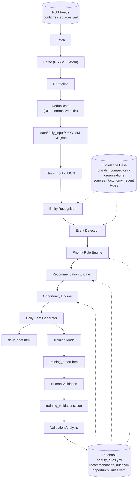

```
████  ████      █   █ █   █ ████  
█   █ █   █     █   █ █   █ █   █ 
█   █ █   █     █████ █   █ █   █ 
████  ████      █   █ █   █ ████  
█     █  █      █   █ █   █ █   █ 
█     █   █     █   █  ███  ████  
```

<p align="center"><strong>Automated PR Intelligence Platform for Stellantis Chile</strong></p>

<p align="center">
  
  
  
  
  
</p>

---

## Overview

**PR HUB** is a rule-based decision engine that turns raw automotive-industry
news into a structured, prioritized daily briefing for the PR & Corporate
Communications team at **Stellantis Chile**. As of Sprint 9, news collection
itself is automated too: `python run_daily.py`, with no arguments, downloads
the day's configured RSS feeds and produces the briefing without any manual
JSON preparation.

Every morning, a Communications Coordinator needs to answer four questions in
under two minutes:

1. What happened?
2. What needs attention today?
3. What opportunities exist?
4. What should I do about it?

PR HUB exists to answer those four questions automatically, from real news,
**without AI-generated judgment calls**. Every classification — brand,
event type, priority, recommendation — is produced by a deterministic,
YAML-configured Rule Engine that a human can read, audit, and correct. There
is no black box: every decision the system makes can be traced back to the
exact rule that produced it.

**Who it's for:** the PR Coordinator who currently has to read a dozen news
sites every morning, and whoever maintains PR HUB's Knowledge Base and
Rulebook as the business evolves.

**Why not just use an LLM to read the news and decide?** Because the whole
point of a decision-support tool for a communications team is that its
judgment has to be *explainable and correctable* — "the AI thought this was
important" is not an acceptable answer when a journalist calls. PR HUB's
core design principle, since its first architectural discussion, has been:
**the model may draft language later; it does not decide priority.** That
boundary is enforced by construction, not by convention — see
[`rule_engine/`](rule_engine/) and [`ARCHITECTURE`](#architecture) below.

---

## Features

- ✓ **RSS Ingestion** — downloads configured feeds (`config/rss_sources.yml`), parses RSS 2.0 and Atom, deduplicates by URL and normalized title, writes `data/daily_input/YYYY-MM-DD.json` — no manual JSON preparation
- ✓ **Rule Engine** — generic, domain-agnostic, YAML-driven condition/outcome evaluator (AND/OR/NOT, `single_winner` / `accumulate_all` resolution)
- ✓ **Knowledge Base** — Brands, Competitors, Organizations, Products, Sources, Taxonomy, Event Types (all in `config/knowledge_base/`)
- ✓ **Entity Recognition** — deterministic alias matching with word-boundary safety and disambiguation context (no NLP, no probabilistic models)
- ✓ **Event Detection** — keyword-based inference of event type when not explicitly provided
- ✓ **Priority Engine** — 17 configured rules (10 active, 7 documented as pending on explicit dependencies)
- ✓ **Recommendation Engine** — maps classified stories to a closed catalog of 9 PR actions
- ✓ **Opportunity Engine** — same deterministic Rule Engine, a separate Rulebook (`config/opportunity_rules.yaml`): surfaces proactive PR opportunities (type, priority, score, justification, recommended action) independently of the base recommendation — a story can be "no action needed" and "worth a proactive opportunity" at the same time, on purpose
- ✓ **Daily Brief** — generates a client-safe (Gmail/Outlook-compatible) HTML executive brief
- ✓ **Training Mode** — a human-in-the-loop validation workflow: run real news through the system, mark each classification correct/incorrect, export the verdicts as JSON
- ✓ **Validation Workflow** — structured analysis (`validation_report.md`, `validation_delta.md`) that turns human corrections into a prioritized, evidence-based improvement backlog
- ✓ **HTML Reports** — `daily_brief.html`, `training_report.html`, both self-contained, no server required

> **Not yet implemented:** scheduled email delivery, sentiment analysis, and
> multi-tenant support. These are staged on the [Roadmap](ROADMAP.md), not
> silently missing — every gap here is a tracked, documented decision, not
> an oversight. Two of the eleven configured RSS feeds also remain
> unverified against a live connection — see
> [`config/rss_sources.yml`](config/rss_sources.yml) and the Ingestion
> section below.

---

## Architecture



The RSS ingestion stage (top) is new in Sprint 9 and is deliberately isolated
from everything below `A["News Input · JSON"]`: it produces exactly the same
input shape that manually-written `noticia.json` files always have, so
nothing downstream — Entity Recognition, the Rule Engine, Daily Brief,
Training Mode — needed to change to support it. If a feed fails, ingestion
continues with the rest (see [`rss/ingest.py`](rss/ingest.py)) — the same
resilience principle already applied per-story elsewhere in the pipeline.

Each stage is an independently swappable pipeline component (see
[`pipeline/stages.py`](pipeline/stages.py)) — Entity Recognition can be
replaced by a more advanced component later without touching Event
Detection, the Rule Engine, or anything downstream. This isn't aspirational:
it's demonstrated in `tests/test_pipeline.py`, which swaps a stage for a
fake implementation mid-test.

The dotted lines are intentional: the Knowledge Base and the Rulebook are
**configuration**, not code. Nothing in `rule_engine/` knows what
"Stellantis" or "Peugeot" means — see
[Repository Structure](#repository-structure) below.

---

## Repository Structure

```
pr-hub/
├── config/
│   ├── knowledge_base/     # brands, competitors, organizations, models,
│   │                       # technologies, sources, taxonomy, event_types
│   ├── rules/               # priority_rules.yml, recommendation_rules.yml
│   ├── opportunity_rules.yaml # Opportunity Engine Rulebook
│   └── rss_sources.yml      # RSS feed catalog (Sprint 9)
├── knowledge_base/          # Knowledge Base Loader (Python)
├── rule_engine/              # Generic, domain-agnostic engine: condition,
│                             # rules, loader, registry, evaluation
├── classification/           # Entity Recognition + Event Detection
├── models/                   # NewsInput dataclass, domain enums
├── pipeline/                  # Decoupled pipeline stages + orchestrator
├── rss/                       # RSS ingestion: fetch, parse, normalize, dedupe
├── opportunity_engine/         # Opportunity Engine: reuses rule_engine/, adds
│                               # a fourth Rulebook (opportunity_rules.yaml)
├── brief/                     # Daily Brief Generator (pure functions, per story)
├── daily/                     # Aggregation, labels, email-safe HTML renderer
├── training/                  # Training Mode: report renderer + validations archive
│   ├── examples/              # 16 REAL news items (Jul/Aug 2026) used for validation
│   └── validations/           # Archived human-validation rounds (JSON)
├── data/daily_input/          # Fictional news samples + RSS-generated YYYY-MM-DD.json
├── examples/                  # Fictional news samples for demoing main.py
│   └── rss_demo/              # Runnable RSS ingestion example (local fixtures, no network)
├── tests/                     # 139 automated tests + fixtures (incl. tests/fixtures/rss/)
├── .github/                   # Issue templates, label proposal
├── main.py                    # Single-story CLI: python main.py noticia.json
├── run_daily.py                # One-command daily CLI: RSS → briefs → both HTML reports
├── run_training.py             # Training Mode CLI: python run_training.py
├── validation_report.md        # Round 1 analysis (accuracy, root causes, backlog)
├── validation_delta.md         # Round 1 → post-fix comparison
├── ROADMAP.md
├── CONTRIBUTING.md
├── CODE_OF_CONDUCT.md
├── SECURITY.md
└── LICENSE
```

---

## Quick Start

**Install:**

```bash
pip install -r requirements.txt
```

**Run the test suite:**

```bash
PYTHONPATH=. pytest tests/ -v
```

**Generate today's Daily Brief + Training Report** (downloads RSS feeds
from `config/rss_sources.yml`, then runs the full pipeline):

```bash
python run_daily.py
# → data/daily_input/YYYY-MM-DD.json
# → daily_brief.html
# → training_report.html
```

If a feed is down or blocked, ingestion continues with the rest and says so
in the console — it won't stop the Daily Brief from being generated with
whatever it did get.

**No network, or want the old fictional demo data instead?**

```bash
python run_daily.py --skip-ingestion
# uses data/daily_input/*.json (fictional Sprint 4 samples) — no network needed
```

**Classify a single news item:**

```bash
python main.py examples/ejemplo_recall_con_impacto_chile.json
```

**Run Training Mode** (16 curated real news items, `training/examples/` —
the fixed benchmark used for accuracy measurement, distinct from whatever
RSS pulls in on a given day):

```bash
python run_training.py
# → training_daily_brief.html
# → training_report.html   (open this one — mark each story Sí/No,
#                            then "Descargar validaciones" for the record)
```

> `run_daily.py` and `run_training.py` both default to writing
> `training_report.html`. Running one after the other overwrites it — use
> `--report-output` on either if you need to keep both around.

See [`config/knowledge_base/`](config/knowledge_base) and
[`config/rules/`](config/rules) for the full YAML input schema, and each
folder's module docstring for design notes and known limitations.

---

## RSS Ingestion

`config/rss_sources.yml` lists 11 feeds. Each entry references a
`source_id` that must already exist in
[`config/knowledge_base/sources.yml`](config/knowledge_base/sources.yml) —
ingestion never creates new Knowledge Base entries on its own.

| Field | Meaning |
|---|---|
| `verified: true` | URL confirmed by an actual web search during Sprint 9 (2 feeds: Diario Financiero, BioBioChile) |
| `verified: false` | Best-effort URL following the site's likely convention (e.g. WordPress `/feed/`), **not confirmed against a live connection** — the development environment this was built in only has access to an allowlisted set of hosts, which didn't include these |
| `enabled: false` + `todo:` | Either unconfirmed enough to trust by default (e.g. Reuters discontinued most public category RSS feeds years ago), or genuinely blocked — `AutoTest` and `Motor1` reference a `source_id` that doesn't exist yet in the Knowledge Base, which is out of scope for this sprint on purpose |

**Before relying on this in production:** verify the `verified: false`
feeds against a real connection and flip the flag, or replace the URL. This
is intentionally not hidden — it's the honest state of the catalog as of
Sprint 9, not a claim that all 11 feeds work today.

**Resilience:** one broken feed (network failure, malformed XML, wrong
credentials, whatever) never stops the rest — see
[`rss/ingest.py`](rss/ingest.py) and
[`tests/test_rss_ingest.py`](tests/test_rss_ingest.py) for the exact
guarantees. This was verified against real (allowlist-blocked) network
calls during development, not only against mocked failures — see
`examples/rss_demo/` below for what that looked like.

**Try it without any network at all:**

```bash
python examples/rss_demo/generate_example.py
```

Runs the exact same ingestion code (`rss/ingest.py`) against local sample
feeds in `tests/fixtures/rss/` — including one that's deliberately
malformed, to demonstrate the graceful-failure path — and produces
`examples/rss_demo/daily_input.example.json`,
`daily_brief.example.html`, and `training_report.example.html`, already
included in this repo so you can open them without running anything.

---

## Current Status

| | |
|---|---|
| **Version** | v0.8-dev (Sprint 9 in progress — see [`ROADMAP.md`](ROADMAP.md)) |
| **Automated tests** | 139 passing, 0 failing (74 core + 51 RSS ingestion + 14 Opportunity Engine) |
| **RSS feeds configured** | 11 total — 9 enabled, 2 verified against a live search, 7 best-effort/unverified or explicitly blocked (see [RSS Ingestion](#rss-ingestion)) |
| **Rulebook coverage** | 10 of 17 rules active (7 documented as pending, each with an explicit blocking dependency) |
| **Estimated accuracy** | ~75% (post-fix estimate against Round 1 of real-news validation — see [`validation_delta.md`](validation_delta.md); a Round 2 with fresh human validation is the next recommended step, not yet run) |
| **Project maturity** | **Internal pilot.** Core decision engine, RSS ingestion, and validation loop are stable and tested; scheduled delivery and sentiment analysis are not yet built (see [Roadmap](ROADMAP.md)) |

---

## Roadmap

See [`ROADMAP.md`](ROADMAP.md) for the full plan from v0.7 (current) through
v1.0 (production-ready).

---

## Contributing

See [`CONTRIBUTING.md`](CONTRIBUTING.md) for branch strategy, commit
conventions, testing requirements, and the PR checklist. See also
[`CODE_OF_CONDUCT.md`](CODE_OF_CONDUCT.md) and
[`SECURITY.md`](SECURITY.md).

---

<p align="center"><sub>PR HUB is an internal tool built for the Stellantis Chile PR & Corporate Communications team. It is not affiliated with, endorsed by, or representing the official Stellantis brand identity.</sub></p>
